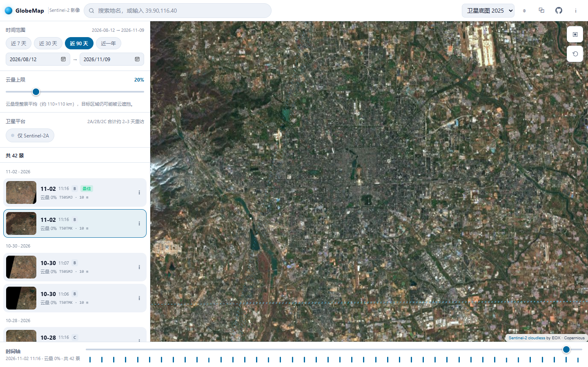
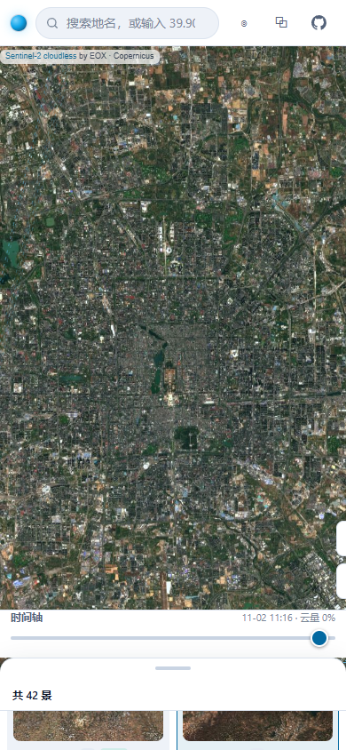
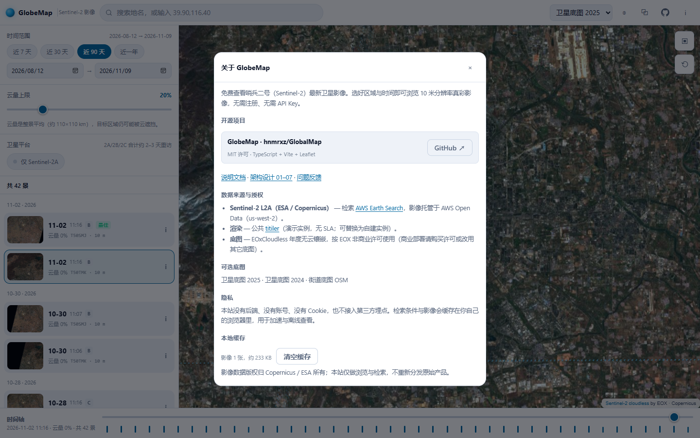

# GlobeMap · Sentinel-2 最新卫星影像检索

> 拖到哪里，就看哪里最新的 **10 米**卫星影像。纯前端、零 API Key、免注册，PC 与手机同一套界面自适应。

[](https://hnmrxz.github.io/GlobalMap/)
[](tsconfig.json)
[](#体积预算)



<p align="center">
  
</p>

---

## 这是什么

一个开箱即用的 Sentinel-2（哨兵 2 号）影像浏览器：

- **打开即用**：默认定位北京，自动检索近 90 天、整景云量 ≤ 20% 的影像，自动选中一景出图 —— 0 次点击。
- **拖地图就换区域**：停稳约 0.6 秒自动重查，不需要点任何"搜索"按钮。
- **看得清**：放大到 z ≥ 13 自动切 10 米分辨率裁剪图，z ≥ 15 用 2048 px。
- **拿得到原图**：详情面板给出 10 m COG 直链、Copernicus Browser 深链、原始 STAC 元数据。

## 快速开始

```bash
npm install

npm run dev        # 开发服务器 http://localhost:5180
npm run build      # 产物 dist/（纯静态，可托管任意 CDN / 对象存储 / Pages）
npm run preview    # 预览构建产物 http://localhost:4173
```

不想装 Node？直接双击 **`standalone.html`** —— 同一套功能的免构建版本（原生 JS + 本地 Leaflet）。

顶栏的 GitHub 图标直达仓库；「关于」面板里能看到仓库、许可、技术栈，以及说明文档 / 架构设计 / 问题反馈的入口。

<p align="center">
  
</p>

### 质量闸门

```bash
npm run typecheck  # tsc --noEmit（strict）
npm test           # vitest：bbox / 日期 / 选景 / 渲染分级 / URL 编解码
npm run smoke      # Playwright 真浏览器：1440×900 + 390×844 截图与 console 检查
npm run interact   # Playwright 真点按：换景 / 改时间 / 仅 2A / 详情 / 换底图 / 缩放
```

`smoke` 与 `interact` 使用系统已装的 Edge/Chrome（`playwright-core`，不下载浏览器），需先 `npm run preview`。

## 功能一览

| 能力 | 说明 |
| --- | --- |
| 自动检索 | 视口变化 → 去抖 400–600 ms → STAC 查询 → 客户端排序（服务端 `sortby` 不可用） |
| 时间筛选 | 近 7 / 30 / 90 天 / 近一年，或自定义起止日期 |
| 云量筛选 | 整景云量上限 0–100%，服务端过滤 |
| 平台筛选 | 默认全星座（2A/2B/2C，2–3 天重访）；可切"仅 Sentinel-2A"（约 10 天重访） |
| 场景列表 | 按天分组、缩略图、云量、平台徽章、"最佳"标记，选中项自动滚入视野 |
| 时间轴 | 底部密度条：一景一柱，柱高与亮度对应影像干净程度 |
| 地图 | Leaflet + EOX 无云镶嵌底图，可切 OSM / 无底图；足迹多边形随结果联动 |
| 详情与下载 | 元数据 + 10 m COG 直链 + Copernicus Browser + STAC JSON |
| 分享 | URL 携带 `z/x/y`、时间区间、云量、平台、选中场景，可回退可刷新 |
| 响应式 | 桌面左栏常驻；手机底部抽屉三档（peek / half / full），可拖拽 |
| 降级 | titiler 失败 → 整景预览 → 缩略图 → 仅足迹，提示条始终可重试 |

## 架构

```
浏览器（静态站点，无自建后端）
├─ ui/        DOM 渲染与事件：map / controls / panels / common
├─ app/       编排：store 订阅、URL 状态、searchFlow、renderFlow
├─ domain/    纯函数（零 I/O，可 100% 单测）：bbox / dates / scene / zoomTier
└─ services/  适配器：STAC 检索、titiler 出图、底图、地名、三级缓存
```

依赖方向是单向的：`domain` 不认识浏览器，`ui` 不直接发请求，所有第三方 URL 集中在 `services/`。详见 [`docs/02-architecture.md`](docs/02-architecture.md)。

### 为什么不是瓦片流

公共 titiler 实例上 **9 张瓦片并发实测 10.3 秒**，无法支撑地图漫游。于是改为

> **一次交互 = 一张裁剪图**

| 缩放 | 策略 | 端点 |
| --- | --- | --- |
| z ≤ 9 | 整景预览（快、省流） | `/cog/preview` |
| z 10–14 | 视口裁剪 1024 px | `/cog/bbox/{bbox}.jpg` |
| z ≥ 15 | 视口裁剪 2048 px | 同上 + `max_size=2048` |

请求带 `AbortController` 与 token 竞态校验，快速拖动不会贴错图；图片走 ``（不受 CORS 约束），IndexedDB 只做"已缓存则秒开"的旁路。

### 体积预算

| 项 | 实际 | 预算 |
| --- | --- | --- |
| JS（gzip） | 60.1 KB（Leaflet 42.4 + 应用 17.7） | ≤ 90 KB |
| CSS（gzip） | 10.7 KB | ≤ 12 KB |
| 字体 | 0（仅系统字体栈） | 0 |

## 数据来源与许可

| 用途 | 服务 | 许可 |
| --- | --- | --- |
| 影像检索 | [AWS Earth Search STAC](https://earth-search.aws.element84.com/v1) `sentinel-2-c1-l2a` | Copernicus 免费开放 |
| 影像出图 | [titiler](https://titiler.xyz) 公共实例 | 演示实例，无 SLA |
| 无云底图 | [Sentinel-2 cloudless](https://cloudless.eox.at) by EOX | **CC BY-NC-SA 4.0，仅非商业** |
| 地名搜索 | [Nominatim](https://nominatim.openstreetmap.org) | ODbL |
| 地图库 | [Leaflet](https://leafletjs.com) | BSD-2-Clause |

> ⚠️ 商业场景请把 EOX 底图换成 OSM 或已授权底图，或购买 EOX 许可。
> 本项目代码以 [MIT](LICENSE) 发布；上述数据与服务各自的许可独立生效。

## 目录结构

```
├─ index.html            入口（含骨架屏、preconnect、无障碍标注）
├─ src/
│  ├─ main.ts            启动
│  ├─ config.ts          唯一配置出口（数据源、阈值、渲染分级）
│  ├─ app/               createApp / store / urlState / searchFlow / renderFlow
│  ├─ domain/            bbox / dates / scene / zoomTier / types
│  ├─ services/          stac / render / basemap / geocode / cache / http
│  ├─ ui/                dom / map / controls / panels / common
│  └─ styles/            tokens / base / layout / components
├─ tests/                vitest 领域单测
├─ tools/                smoke.mjs / interact.mjs（Playwright 真浏览器）
├─ docs/                 01–07 架构规格 + 验证截图
├─ public/               favicon 等静态资源
└─ standalone.html       免构建版本入口（js/ css/ vendor/）
```

## 部署

线上地址：**<https://hnmrxz.github.io/GlobalMap/>**

已接入 **GitHub Actions 自动部署**（[.github/workflows/deploy.yml](.github/workflows/deploy.yml)）：
推送到 `main` 即触发 → `npm ci` → 类型检查 → 单元测试 → `vite build` → 发布到 Pages。
也可以在 Actions 页面手动 `workflow_dispatch`。

Pages 源（Repository → Settings → Pages → Build and deployment）：**GitHub Actions**。

`vite.config.ts` 里 `base: './'`，产物是相对路径，同一份 `dist/` 也能直接丢到任意 CDN / 对象存储 / 子路径。

## 已知限制

- **"最新"受云量约束**：整景云量 0% 不代表你的目标区域无云。像元级云掩膜（SCL）属于后续计划。
- **仅 2A 会显著变慢**：单星重访约 10 天，全星座约 2–3 天。
- **公共渲染实例无 SLA**：失败会自动降级并在提示条提供重试；`src/config.ts` 一行可切到自建 titiler。
- **10 m 是数据上限**：z ≥ 17 会过采样，属数据本身限制。
- 控制台偶发 `ERR_FAILED`：后台预热 IndexedDB 缓存时对同一 URL 再 fetch 一次，titiler 报错时响应无 CORS 头导致；不影响出图。

## 设计文档

| 文档 | 内容 |
| --- | --- |
| [01 数据源对比](docs/01-data-sources.md) | 候选源逐项对比、选型与降级链、授权风险 |
| [02 架构与目录](docs/02-architecture.md) | 技术选型、分层规则、配置项、URL 契约 |
| [03 页面与组件](docs/03-ui-components.md) | 线框图、组件契约、主流程、三态设计 |
| [04 检索与影像加载](docs/04-imagery-loading.md) | 坐标系、STAC 构造、渲染分级、缓存、降级 |
| [05 响应式与移动端](docs/05-responsive-mobile.md) | 断点、触控、首屏预算 |
| [06 实施阶段与风险](docs/06-roadmap-risks.md) | P0–P6 清单、验收标准、风险登记 |
| [07 架构决策记录](docs/07-adr.md) | ADR-001 ~ ADR-005 |
